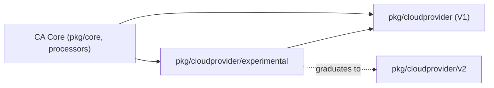

# Experimental Cloud Provider Interfaces (`pkg/cloudprovider/experimental`)

> **Stability Warning:** This package is an explicit exception to the [API Stability Policy](../../../CODE_CONVENTIONS.md#api-stability-policy). Interfaces and helpers here carry **no backward-compatibility guarantees** and may change or be removed without deprecation cycles until promoted to `pkg/cloudprovider/v2`.

**Goal:** Enable fast, incremental iteration toward a next-generation Cloud Provider interface (`v2`) while keeping Cluster Autoscaler core readable, avoiding big-bang rewrites, and supporting safe mixed V1/V2 rollouts in production.

---

## Why This Package Exists

Designing a complete Cloud Provider V2 upfront in a vacuum risks slow feedback loops, speculative abstractions, and painful all-or-nothing migrations. At the same time, adding ad-hoc optional interfaces directly to `pkg/cloudprovider` and branching inline across core creates three predictable hazards:

1. **Core readability degrades** as `if v2, ok := ng.(...); ok { ... } else { ... }` blocks spread across scheduling, scaling, and state tracking.
2. **Silent fallback bugs** occur easily in Go-wrapping a `NodeGroup` or `CloudProvider` (caching, metrics, mocks) silently breaks raw type assertions.
3. **Permanent migration debt** accumulates when experimental interfaces have no clear boundary, contract, or exit criteria.

This package provides a structured path for **fast plug-in experimentation** with **clean, auditable boundaries**.

---

## Core Guidelines

### 1. Package Boundary & Interface Design



- **Clean wall from V1:** `pkg/cloudprovider/experimental` may import `pkg/cloudprovider` for shared value types (e.g., `Instance`, `ErrNotImplemented`), while `pkg/cloudprovider` stays untouched. Every experimental touchpoint in core is immediately auditable via a single import.
- **Do not embed V1 interfaces:** Define narrow, standalone interfaces (e.g., `InstanceCreator`) without embedding `cloudprovider.NodeGroup` or `cloudprovider.CloudProvider`. Providers still satisfy them via Go structural typing, mocks stay minimal, and future `v2` interfaces are not welded to V1's shape.
- **No chained fallbacks (max depth = 1):** Never stack `V3 -> V2 -> V1` fallbacks. Iterate by modifying experimental interfaces in place.

---

### 2. Keeping Core Readable: Two Tiers of Integration

Choose the integration pattern based on the depth of the change:

| Change Type | Pattern | Rule |
|---|---|---|
| **Local / Contract upgrade** *(e.g., returning created instance IDs on scale-up, richer error info)* | **Gateway Helper** | Never type-assert or branch inline inside core algorithms. Place **one** gateway helper next to the interface in `pkg/cloudprovider/experimental` that owns discovery, fallback, and V2-vs-V1 telemetry. |
| **Deep / Paradigm shift** *(e.g., async/reconciler loops, moving beyond `NodeGroup`-centric scaling)* | **Coarse Subsystem Seam** | Do not weave multiple `if v2` checks through existing functions. Lift the branch to a high-level seam (e.g., a Processor, Executor, or Strategy) with a clean experimental implementation alongside the legacy one. Accept small, localized duplication over tangled conditionals. |

---

### 3. Safe Mixed V1/V2 Production Rollouts

Providers often need to adopt new interfaces gradually within the **same** cluster (e.g., per node pool or workload type) rather than via an on/off cluster switch:

1. **Wrapper-safe discovery (`As[T]` + `Unwrap()`):** Use a generic `cloudprovider.As[T](obj)` helper (mirroring `errors.As`) backed by an `Unwrap()` convention on wrapper/decorator types. Always use `cloudprovider.As[T]` rather than raw Go type assertions (`obj.(T)`).
2. **Strict runtime opt-out semantics:** Because a Go type satisfies an interface at compile time for *all* instances, per-pool rollout requires dynamic opt-out:
   - *Leaf calls (reactive):* Returning `cloudprovider.ErrNotImplemented` **must have zero cloud side effects**. Real errors must propagate and **never** fall back to V1 (preventing duplicate mutations).
   - *Multi-step / planning changes (proactive):* Expose an explicit runtime capability predicate/accessor so core knows *before* planning or mutating state.
3. **Unified core state:** Mixed V1 and V2 node groups must feed **one shared core data model** (V2 enriches fields that V1 leaves inferred/empty). Avoid parallel V1 and V2 state trackers that cross-pool logic must reconcile.

---

### 4. Concrete Example

```go
// pkg/cloudprovider/experimental/scaling.go
package experimental

import (
	"context"
	"errors"

	"sigs.k8s.io/cluster-autoscaler/pkg/cloudprovider"
)

// InstanceCreator is a standalone narrow interface - it does NOT embed cloudprovider.NodeGroup.
type InstanceCreator interface {
	IncreaseSizeWithInstances(ctx context.Context, delta int) ([]cloudprovider.Instance, error)
}

// IncreaseSizeOrFallback is the single gateway helper encapsulating discovery, fallback, and telemetry.
func IncreaseSizeOrFallback(ctx context.Context, ng cloudprovider.NodeGroup, delta int) ([]cloudprovider.Instance, error) {
	if creator, ok := cloudprovider.As[InstanceCreator](ng); ok {
		instances, err := creator.IncreaseSizeWithInstances(ctx, delta)
		if !errors.Is(err, cloudprovider.ErrNotImplemented) {
			return instances, err // Never fall back on real errors.
		}
	}
	return nil, ng.IncreaseSize(ctx, delta)
}
```

Core calls `experimental.IncreaseSizeOrFallback(ctx, ng, delta)`-one linear call site, zero inline type assertions, safe for wrapped `NodeGroup`s, and ready for per-pool gradual rollout.

---

### 5. Recommended Validation & Lifecycle Hygiene

To streamline iteration, the practices below are **recommended rather than hard requirements**-apply them where practical to keep `experimental` converging toward `v2` instead of becoming a permanent attic:

- **`kwok` reference implementation (where feasible):** When an interface maps naturally to `kwok`, consider adding a `kwok` implementation (ideally with mixed-mode toggling) so both V1 and V2 paths can be exercised in OSS CI. Given `kwok`'s intentional simplicity, some cloud-specific interfaces may be difficult or impractical to model there and can rely on unit/downstream tests instead.
- **4-case unit test matrix** for gateway helpers:
  1. Experimental interface implemented and succeeds
  2. Not implemented (`!ok`) → falls back to V1
  3. Implemented and dynamically returns `ErrNotImplemented` → falls back to V1
  4. Implemented and returns a real error → propagates error and asserts V1 is **not** called
- **Registry tracking:** List new experimental interfaces in the table below with an owner and rough graduation/removal criteria so reviewers and future contributors have shared visibility.

---

## Why This Benefits the Community

- **Core maintainers** keep core single-path and readable, gain instant visibility into all experimental dependencies, and get clean deletion paths once V2 stabilizes.
- **Cloud provider authors** are shielded from churn in `pkg/cloudprovider` (see [POLICY.md](../POLICY.md)) until interfaces are battle-tested in production (and `kwok` where applicable), and can adopt V2 gradually rather than via big-bang rewrites.
- **Cluster operators** get safer incremental rollouts with built-in telemetry comparing experimental usage against V1 fallbacks.

---

## Active Experimental Interfaces

| Interface | Domain | Owner | Status | Graduation / Removal Criteria |
|---|---|---|---|---|
| `InstanceCreator` | Scaling | @Choraden | Active | Validated in production and ready to promote to `pkg/cloudprovider/v2` (or remove if superseded) |
