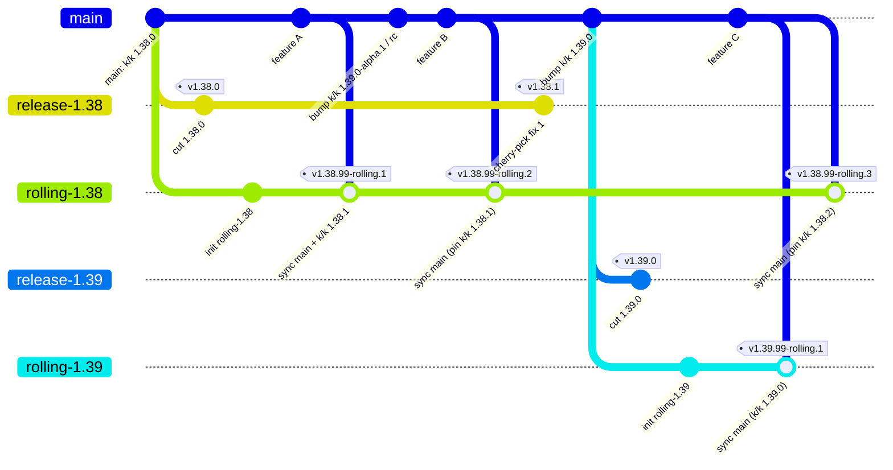

# AEP-176: Two-Track Semantic Versioning for Core Cluster Autoscaler
*   **Issue**:
    [kubernetes-sigs/cluster-autoscaler#176](https://github.com/kubernetes-sigs/cluster-autoscaler/issues/176)
*   **Authors**: `@BigDarkClown`
*   **Status**: Provisional
<!-- toc -->
-   [Summary](#summary)
-   [Motivation](#motivation)
    -   [Goals](#goals)
    -   [Non-Goals](#non-goals)
-   [Proposal](#proposal)
    -   [Track 1: Stable Track (`release-1.X`)](#track-1-stable-track-release-1x)
    -   [Track 2: Rolling Track (`rolling-1.X`)](#track-2-rolling-track-rolling-1x)
    -   [Version Progression](#version-progression)
-   [Design Details](#design-details)
    -   [Tagging Scheme, SemVer, and Go MVS Semantics](#tagging-scheme-semver-and-go-mvs-semantics)
    -   [Automated Sync, Dependency Updates, and Tagging Workflows](#automated-sync-dependency-updates-and-tagging-workflows)
    -   [GitHub Actions Maintenance Feasibility Evaluation](#github-actions-maintenance-feasibility-evaluation)
    -   [Transition Plan (`1.37` to `1.38`)](#transition-plan-137-to-138)
    -   [Test Plan](#test-plan)
    -   [Feature Enablement and Rollback](#feature-enablement-and-rollback)
    -   [Kubernetes Version Compatibility](#kubernetes-version-compatibility)
-   [Implementation History](#implementation-history)
-   [Alternatives](#alternatives)
<!-- /toc -->
## Disclaimer
This proposal was generated using AI tooling based on the initial discussion in
#176 and the follow-up discussions in comments. It has been reviewed and formatted
by me and represents my current understanding of the proposal.
## Summary
`kubernetes-sigs/cluster-autoscaler` (`sigs.k8s.io/cluster-autoscaler`) is
consumed as a Go library by `kubernetes/autoscaler` and downstream
cloud-provider implementations. This AEP introduces a **two-track Semantic
Versioning scheme** starting with Kubernetes `1.38`:
1.  **Stable Track (`release-1.X` branches)**: Cuts `v1.X.0` at each Kubernetes
    minor release, followed by periodic `v1.X.Z` patch releases with
    cherry-picked bug fixes.
2.  **Rolling Track (`rolling-1.X` branches, max 2 active, best-effort)**:
    Per-minor branches created alongside `release-1.X` at `1.X.0`, continuously
    synced with `main` on a **best-effort** basis while pinning the newest
    stable `k8s.io/kubernetes` `1.X` patch, and tagged weekly (or on demand) as
    **`v1.X.99-rolling.Y`**. Maintainers may retire a rolling branch early if
    maintenance toil becomes too high.
Release tags live exclusively on `release-1.X` and `rolling-1.X`, leaving `main`
free to adopt upcoming Kubernetes `alpha`/`beta`/`rc` versions while providing
strictly monotonic versions excluded from `go get @latest`.
## Motivation
Cluster Autoscaler is tightly coupled to the `k8s.io/kubernetes` minor version
it vendors: a cluster running Kubernetes `1.X` needs a CA built against `1.X` so
in-memory scheduler simulations match `kube-scheduler`. While Scheduler-Driven
Autoscaling (SDA) will eventually relax this constraint,
`sigs.k8s.io/cluster-autoscaler` needs a clear versioning model today.
Now that core CA is consumed as a Go library rather than only as a standalone
binary tied to quarterly Kubernetes releases, relying solely on `release-1.X`
branches and raw `main` commits creates several gaps:
*   **Slow feature adoption**: Waiting 3–4 months for the next `release-1.X`
    branch is too slow for cloud-specific implementations integrating new core
    features.
*   **Unstable Kubernetes deps on `main`**: `main` often adopts upcoming
    Kubernetes `alpha`, `beta`, or `rc` versions early to adapt to upstream
    changes, making `main` commits unusable for consumers on stable Kubernetes
    versions.
*   **Multi-minor support**: Cloud providers run multiple Kubernetes minors
    concurrently and benefit from consuming recent library changes across more
    than one minor at a time.
*   **Opaque versions**: Consuming raw commits produces Go pseudo-versions (or
    ad-hoc tags like `v0.0.0-k8s.v1.37.0`) that obscure the targeted Kubernetes
    minor.
### Goals
*   Define a two-track release scheme (`release-1.X` and `rolling-1.X`) in time
    for Kubernetes `1.38`.
*   Let `main` adopt Kubernetes `alpha`/`beta`/`rc` versions early without
    disrupting fast-track releases for stable minors.
*   Support concurrent rolling releases for **up to 2 active Kubernetes minors**
    (`rolling-1.X` and `rolling-1.(X-1)`).
*   Encode the vendored `k8s.io/kubernetes` minor (`1.X`) in every tag.
*   Ensure **strict SemVer 2.0.0 monotonicity** for Go MVS and pseudo-versions,
    while keeping `go get @latest` pointed only at stable `v1.X.Z` releases.
*   Automate `main` syncs, same-minor Kubernetes bumps, and weekly rolling tags
    (with manual on-demand triggers).
### Non-Goals
*   **Go API backwards-compatibility / deprecation policy**: `v1.X` denotes
    Kubernetes `1.X` compatibility, not a strict Go SemVer `v1` API freeze.
    Deprecation windows (e.g., `+/- 3` minors) and refactor adapters (e.g.,
    `CloudProvider`) belong in a separate SIG proposal.
*   **Lockstep versioning for `cluster-autoscaler/apis` or internal
    submodules**: `cluster-autoscaler/apis` stays on pseudo-versions in
    `kubernetes/autoscaler` until migrated; `./pkg/e2e` and `./tools` are
    internal modules out of scope for release tags.
*   **SLAs for `rolling-1.X` branches**: Rolling maintenance is strictly
    best-effort with no guarantee a branch stays active until `rolling-1.(X+2)`
    opens.
*   **More than 2 concurrent `rolling-1.X` branches**: Syncing 3+ historical
    minors compounds Kubernetes API and Go toolchain drift beyond sustainable
    automation.
*   **Decoupling CA from `kube-scheduler` minors**: Covered by SDA.
## Proposal
Release tags for `sigs.k8s.io/cluster-autoscaler` are cut only on `release-1.X`
and `rolling-1.X` branches. The `main` branch remains the active development
branch and can adopt upcoming Kubernetes `alpha`, `beta`, or `rc` versions as
needed.
### Track 1: Stable Track (`release-1.X`)
*   At each Kubernetes `1.X.0` release, cut `release-1.X` and tag **`v1.X.0`**
    (starting at `1.38`).
*   Release cherry-picked bug fixes periodically (e.g., every 2–3 months, or
    sooner for critical fixes) as **`v1.X.1`**, **`v1.X.2`**, etc.
### Track 2: Rolling Track (`rolling-1.X`)
*   **Creation**: Cut `rolling-1.X` at `1.X.0` alongside `release-1.X`.
*   **Sync and pinning**: Continuously sync `rolling-1.X` from `main` while
    pinning `k8s.io/kubernetes` (and staging `k8s.io/*`) to the **newest stable
    `1.X` release** via `hack/update-deps.sh`.
*   **Tag format**: **`v1.X.99-rolling.Y`** (e.g., `v1.38.99-rolling.1`,
    `v1.38.99-rolling.2`), where `Y` is a `1`-based sequential counter
    independent of upstream Kubernetes patch numbers.
*   **Cadence**: Tagged **weekly** by automation when new commits or dependency
    bumps land, plus manual `workflow_dispatch` for mid-week tags.
*   **Branch cap (max 2 active)**: At most **2 `rolling-1.X` branches** are
    actively synced and tagged concurrently (e.g., `rolling-1.38` and
    `rolling-1.39`). Opening `rolling-1.(X+2)` at `1.(X+2).0` retires
    `rolling-1.X`.
*   **Best-effort maintenance and early stop**: Maintenance of `rolling-1.X` is
    **best-effort**. Active `main` development relying on Kubernetes APIs
    unavailable in minor `1.X` can quickly outdate a rolling branch and require
    heavy reverts or shims, so **maintainers may stop a `rolling-1.X` track
    early** once toil becomes too large. Retired branches and tags stay
    immutable in Git; consumers on `1.X` fall back to `release-1.X` or upgrade
    to `rolling-1.(X+1)`.
### Version Progression

```text
release-1.38: v1.38.0 -> v1.38.1 -> v1.38.2 -> ...
rolling-1.38: v1.38.99-rolling.1 -> v1.38.99-rolling.2 -> ... (retired at 1.40.0 or earlier)
```
## Design Details
### Tagging Scheme, SemVer, and Go MVS Semantics
Sentinel patch `.99` with the `-rolling` pre-release suffix
(`v1.X.99-rolling.Y`) satisfies SemVer 2.0.0 and Go module tooling:
<!-- mdformat off -->
| Property | Behavior | Why It Works |
| :--- | :--- | :--- |
| **Monotonicity** | `v1.37.99-rolling.K < v1.38.0 < v1.38.1 < v1.38.99-rolling.1 < v1.38.99-rolling.10 < v1.39.0` | `.99` sorts above all real `1.38.Z` patches while staying strictly below `v1.39.0`. |
| **Go MVS upgrades** | Moving from `v1.38.0` (or `v1.38.2`) to `v1.38.99-rolling.1` is always an upgrade. | Avoids `v1.38.0-rolling.1 < v1.38.0`, which causes MVS to prefer `v1.38.0` over rolling builds. |
| **Go pseudo-versions** | Untagged commits on `rolling-1.38` resolve to `v1.38.99-rolling.2.0.<timestamp>-<sha>`. | Since `v1.38.99-rolling.Y > v1.38.0`, `cmd/go` selects the latest rolling tag as the base. |
| **`@latest` safety** | `go get sigs.k8s.io/cluster-autoscaler@latest` resolves to the highest stable `v1.X.Z`. | Pre-release tags (`-rolling.Y`) are skipped by `@latest` whenever any stable release exists. |
| **Numeric `Y` sorting** | `rolling.2 < rolling.10` | SemVer 2.0.0 compares pure numeric dot-separated identifiers numerically. |
> [!NOTE]
> Patch `.99` is reserved for `rolling-1.X` tags (`v1.X.99-rolling.Y`); stable `release-1.X` branches only cut `v1.X.0` through `v1.X.98`.
<!-- mdformat on -->
### Automated Sync, Dependency Updates, and Tagging Workflows
Two GitHub Actions workflows operate over an explicit list of **at most 2 active
`rolling-1.X` branches**:
#### 1. Sync and Same-Minor Dependency Update Workflow
*   **Triggers**: Scheduled (daily or weekly, ahead of tagging) and manual
    `workflow_dispatch`.
*   **Append-only history**: Uses merge commits (never force-pushed rebases) so
    published tags cached by `proxy.golang.org` and `sum.golang.org` stay
    reachable.
*   **Steps**:
    1.  Checks out `rolling-1.X` onto a `sync/rolling-1.X` branch and runs
        `git merge --no-ff origin/main`.
    2.  Queries upstream `kubernetes/kubernetes` for the newest stable `v1.X.*`
        patch tag (excluding pre-releases). If `main` has moved to `1.(X+1)+` or
        a newer `1.X.Z` patch exists, restores `rolling-1.X`'s `1.X` pin across
        `.`, `./pkg/e2e`, and `./tools`, runs `hack/update-deps.sh <1.X.Z>
        https://github.com/kubernetes/kubernetes.git`, and runs `go mod tidy`.
    3.  Opens or updates a single sync PR targeting `rolling-1.X` gated by
        `verify.yaml`, `ca-test.yaml`, and `ca-e2e.yaml`.
    4.  If merge conflicts or `1.(X+1)` Kubernetes API build failures occur, the
        PR stays open for a maintainer to push a compatibility fix/revert—or
        retire `rolling-1.X` early if toil is excessive.
#### 2. Weekly Rolling Tagging Workflow
*   **Triggers**: Weekly `schedule` over active `rolling-1.X` branches, plus
    `workflow_dispatch` (including `dry_run`).
*   **Steps**:
    1.  Exits as a no-op if `HEAD` of `rolling-1.X` already has a `v1.*` tag.
    2.  Verifies required CI checks (`verify`, `ca-test`) passed on `HEAD`.
    3.  Validates that `k8s.io/kubernetes` in `go.mod` is a stable
        `v1.<minor>.<patch>` release matching the branch minor (failing fast on
        pre-releases).
    4.  Computes `Y = max(existing Y for v1.<minor>.99-rolling.*) + 1` (starting
        at `1`) and pushes an annotated tag `v1.<minor>.99-rolling.<Y>`.
### GitHub Actions Maintenance Feasibility Evaluation
Maintaining `rolling-1.X` via GitHub Actions is **feasible under the 2-branch
cap and best-effort policy**, with effort scaling sharply as a rolling branch
lags behind `main`:
<!-- mdformat off -->
| Lifecycle Phase | Automation Difficulty | Human Intervention | Primary Failure Modes |
| :--- | :--- | :--- | :--- |
| **`main` on same minor (`1.X`)** | **Low** — Nearly 100% automated | Minimal (PR merge if protected) | Rare `go.mod` conflict if `rolling-1.X` picks up `1.X.Z` before `main`. |
| **`main` 1 minor ahead (`1.(X+1)` alpha/beta/rc/GA)** | **Moderate** — Mechanical sync works, periodic breaks | Periodic (~1–3 fixes/reverts per month; may stop early) | Daily Dependabot `go.mod`/`go.sum` collisions; Go compile breaks on `1.(X+1)` scheduler/DRA APIs. |
| **`main` 2+ minors ahead (bounded by 2-branch cap)** | **High** — Mostly broken sync PRs | Heavy manual backporting | Go toolchain bumps (e.g., Go 1.26 -> 1.27), `controller-runtime` drift, stacked conflict reverts. |
<!-- mdformat on -->
#### Repo-Specific Constraints Verified in `kubernetes-sigs/cluster-autoscaler`
1.  **Prow Branch Protection, `EasyCLA`, and `GITHUB_TOKEN`**:
    `kubernetes/test-infra` (`config/prow/config.yaml`) enables `protect: true`
    and `EasyCLA` on all `kubernetes-sigs` branches by default. Direct GHA
    pushes to `rolling-1.X` are blocked; PRs opened by `GITHUB_TOKEN` do not
    trigger `pull_request` workflows; `github-actions[bot]` commits hit
    `EasyCLA`; and Tide requires `/lgtm` + `/approve`. Pushing Git tags with
    `GITHUB_TOKEN` (`contents: write`) works once commits merge, but PR sync
    automation requires either a SIG ContribEx-approved bot/GitHub App or
    lightweight maintainer review/triggering.
2.  **Kubernetes API Drift (Unautomatable)**: Recent history (`release-1.37` to
    `main`: ~200 commits, 165 files) concentrates heavily in
    `pkg/simulator/{clustersnapshot,dynamicresources,csi}` and
    `pkg/core/{scaledown,scaleup}`. Features on `main` calling `1.(X+1)`
    scheduler or DRA APIs will fail compilation on `rolling-1.X`, requiring
    manual shims or reverts that increase future merge conflicts.
3.  **Daily Dependabot Churn Across 3 Modules**: `.github/dependabot.yml` bumps
    non-`k8s.io/*` deps daily, and `hack/update-deps.sh` updates `.`,
    `./pkg/e2e`, and `./tools`, so post-divergence syncs routinely hit
    `go.mod`/`go.sum` conflicts.
4.  **Push CI Triggers**: `ca-test.yaml`, `verify.yaml`, and `ca-e2e.yaml`
    currently set `on.push.branches: [main]` and must add `rolling-*` (and
    `release-*`) so commit statuses exist on `HEAD` for the tagging check.
5.  **`hack/update-deps.sh` SSH Default**: Defaults `FORK` to
    `git@github.com:kubernetes/kubernetes.git`, which fails on keyless GHA
    runners unless passed `https://github.com/kubernetes/kubernetes.git` as `$2`
    (or changed to HTTPS).
**Verdict**: **Moderate effort and practical** with PR-based syncs, GHA tagging,
the **2-branch cap**, and an explicit config list allowing maintainers to freeze
a `rolling-1.X` branch early whenever revert toil grows too large.
### Transition Plan (`1.37` to `1.38`)
*   **`release-1.37`**: Keep existing transitional tags `v0.0.0-k8s.v1.37.0` and
    `v0.0.0-k8s.v1.37.1` untouched
    (`v0.0.0-... < v1.37.99-rolling.1 < v1.38.0`). An optional `rolling-1.37`
    pilot may exercise the workflows ahead of `1.38`.
*   **Launch at `1.38`**:
    1.  At Kubernetes `v1.38.0` GA, cut `release-1.38` (tagging `v1.38.0`, then
        periodic `v1.38.Z` patches) and `rolling-1.38` (best-effort weekly
        `v1.38.99-rolling.Y` tags).
    2.  When `main` adopts `1.39` pre-releases, `rolling-1.38` continues syncing
        from `main` while pinning stable `1.38.x` (unless retired early by
        maintainers).
    3.  At `1.39.0`, cut `rolling-1.39` alongside `release-1.39` (2 active
        rolling branches); opening `rolling-1.40` at `1.40.0` retires
        `rolling-1.38`.
### Test Plan
*   **Script unit tests**: Verify stable `1.38.Z` -> `v1.38.99-rolling.Y`
    computation and numeric incrementing (`9 -> 10`), rejection of pre-release
    k/k versions (`1.38.0-rc.1`, `1.39.0-alpha.0`) and `main` as tagging
    targets, no-op behavior on already-tagged `HEAD`, and same-minor stable-only
    upstream tag filtering.
*   **Dry-run workflows**: Support `dry_run: true` via `workflow_dispatch` on
    sync and tagging workflows.
*   **Go module resolution check**: Verify `go list -m -versions` orders all
    tags monotonically and `go get @latest` selects `v1.X.Z` over
    `v1.X.99-rolling.Y`.
### Feature Enablement and Rollback
*   No runtime feature gate is needed (repo branching and CI change only).
*   Workflows can be disabled or a `rolling-1.X` branch removed from the active
    config list at any time without affecting `main` or `release-1.X`.
*   **Tag immutability**: Never delete/re-point published tags or force-push
    `rolling-1.X` (breaks `sum.golang.org` / `proxy.golang.org`). Fix issues by
    cutting `rolling.(Y+1)` or adding a Go `retract` directive to `go.mod`.
### Kubernetes Version Compatibility
Every `v1.X.*` tag (`v1.X.Z` on `release-1.X` and `v1.X.99-rolling.Y` on
`rolling-1.X`) is built and tested against a stable `k8s.io/kubernetes` `1.X`
release; consumers targeting Kubernetes `1.X` should select a matching `v1.X.*`
tag.
## Implementation History
*   `2026-10-14`: Initial versioning proposal opened in
    [kubernetes-sigs/cluster-autoscaler#176](https://github.com/kubernetes-sigs/cluster-autoscaler/issues/176).
*   `2026-11-26`: Drafted AEP-176 defining `release-1.X` and best-effort
    `rolling-1.X` (max 2 active) tracks, `.99-rolling.Y` SemVer scheme, and
    GitHub Actions feasibility evaluation.
## Alternatives
### 1. Tagging `main` directly (`v1.X.99-snapshot.Y` / `v1.X.0-rc-snapshot.Y`)
*   **Description**: Tag `main` weekly/on-demand based on the
    `k8s.io/kubernetes` version in `main`'s `go.mod`.
*   **Why rejected**:
    1.  **Brittle under early Kubernetes bumps**: Updating `main` early to
        `1.(X+1)` `alpha`/`beta`/`rc` immediately cuts off `1.X` releases, with
        no guarantee of multiple fast-track tags per minor.
    2.  **Single-minor limit**: Even without early bumps, `main` can serve at
        most one newest minor at a time rather than multiple active minors
        concurrently.
### 2. Cherry-picking commits from `main` to `rolling-1.X` instead of merge commits
*   **Description**: Use a bot to cherry-pick individual non-k8s-bump PRs from
    `main` onto `rolling-1.X`.
*   **Why rejected**: Drops shared Git ancestry with `main` across ~100+ commits
    per minor, complicates auditing, and still conflicts whenever later commits
    touch files altered by skipped bump PRs.
### 3. Post-release rolling tags with patch `.0` (`v1.X.0-rolling.Y` / `v1.X.0-weekly.Y`)
*   **Description**: Tag `rolling-1.X` as `v1.38.0-rolling.Y`.
*   **Why rejected**: Under SemVer 2.0.0, `v1.38.0-rolling.1 < v1.38.0`, causing
    Go MVS downgrades and causing `cmd/go` to ignore rolling tags when computing
    pseudo-versions after `v1.38.0`. Sentinel `.99` stays monotonic while
    `@latest` still ignores pre-releases.
### 4. Next-minor `-alpha.Y` tags (`v1.(X+1).0-alpha.Y`, `client-go` style)
*   **Description**: Tag post-`v1.38.0` rolling builds as `v1.39.0-alpha.Y`
    while still vendoring Kubernetes `1.38.x`.
*   **Why rejected**: Misleads consumers about which Kubernetes minor CA's
    scheduler simulation targets.
### 5. Using `-rc.Y`, `-weekly.Y`, or `-snapshot.Y` (or RC tags on `rolling-1.X`)
*   **Description**: Use `-rc.Y`, `-weekly.Y`, or `-snapshot.Y`, or cut
    `rolling-1.X` during Kubernetes RC with `v1.X.0-rc-rolling.Y`.
*   **Why rejected**: `-rc.Y` is misleading for post-GA feature builds (and
    starting `rolling-1.X` at `1.X.0` keeps RCs isolated to `main`); `-weekly.Y`
    ties naming to a fixed schedule; `-rolling.Y` directly matches `rolling-1.X`
    branches.
### 6. Automatic per-backport pre-release tags on `release-1.X`
*   **Description**: Tag every merged cherry-pick on `release-1.X` (e.g.,
    `v1.X.1-rc.N`) ahead of `v1.X.Z`.
*   **Why deferred**: Periodic `v1.X.Z` releases (plus pseudo-versions for
    urgent testing) keep `release-1.X` simple; `-rc.N` tags remain compatible if
    needed later.
### 7. Continuing with `v0.0.0-k8s.v1.X.Z` tags or raw pseudo-versions
*   **Description**: Keep bootstrap `v0.0.0-k8s.v1.37.Z` tags and raw commits.
*   **Why rejected**: Prevents `go get @latest` discovery of stable releases and
    gives poor consumer ergonomics.
